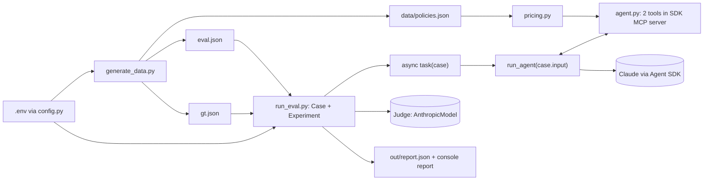

# Build Prompt: Insurance Pricing Agent (Claude Agent SDK) Evaluated with Strands Evals

> Paste this whole file to a coding agent as the build instruction. It keeps the business domain of the earlier Strands brief (insurance price comparison, 5 insurers, 4 policy types, 20 plans, exact ground truth) and changes the technical stack: **the agent is built with the Claude Agent SDK** and **evaluated with Strands Evals**.

---

## 0. Non-negotiable rules (read first, apply to every step)

**R1. Do not hallucinate.**
- Never write an import, class, parameter or CLI flag from memory. Before using any third-party API, confirm it in **both** the official docs (links in section 9) **and** the installed package (`uv run python -c "import inspect, X; print(inspect.signature(X.Y))"` or `help(X.Y)`).
- If something cannot be confirmed, **stop and say so**. Do not guess, and do not invent a workaround that looks plausible.
- Do not invent model IDs. Look up current IDs on the Anthropic models overview page and put them in `.env.example`.
- State only what you actually ran. Do not report "tests pass" or "no errors" unless you ran the command and have its output.

**R2. Search the web when needed.** Use web search or fetch for: current package versions, current model IDs, and any API in section 8 marked **VERIFY**. Prefer official docs and the package's own repository.

**R3. DRY.** Each fact lives in exactly one place:
- the pricing formula and plan lookup: `pricing.py` only (used by the tools **and** by the ground-truth generator);
- tool names and descriptions: one `TOOLS` constant, used by the agent, the trajectory parsing and the trajectory evaluator description;
- evaluator rubrics: `eval.json` only;
- configuration: `config.py` only.

**R4. KISS.**
- Plain functions and plain dicts. A class only where a library requires one.
- No retries, caching, plugins, abstract base classes, config frameworks or extra CLI flags.
- Build only what this brief lists. Anything not listed is out of scope (see section 10).
- Prefer the library's documented, simplest API over a clever one.

**R5. No compilation or import errors, before and after execution.**
- Python 3.12+, fully type-annotated with built-in generics (`list[str]`, `X | None`).
- Run the gates in section 7 **before** the first eval run and **again after** it. All must pass with zero errors and zero warnings you introduced.
- Fix the cause of any failure. Do not silence it with `# type: ignore`, `noqa` or broad `except`.

---

## 1. Business domain (unchanged)

- Domain: **insurance price comparison**. A customer gives a policy type, age, coverage amount and deductible.
- Four policy types: **auto, home, term_life, health**.
- Catalog: **5 insurers** (Aegis Mutual, Northwind Assurance, Bluepeak Insurance, Cedar & Stone, Harbor Shield), one plan per policy type, so **20 plans**.
- The agent returns **the cheapest plan** (plan name, insurer, plan_id) and its **annual premium in USD**.
- Prices come **only from tool results**, never from the model's knowledge. This keeps answers exactly checkable.

## 2. What we build

A pricing agent on the **Claude Agent SDK** (`claude-agent-sdk`), with its two tools served by an **in-process SDK MCP server**. It is evaluated by **Strands Evals** (`strands-agents-evals`) using two LLM judges that also run on Claude through the Anthropic API. No AWS or Bedrock dependency.

### 2.1 Stack

Python >= 3.12, `uv`, `hatchling`.

| Package | Used for |
|---|---|
| `claude-agent-sdk` | `query`, `ClaudeAgentOptions`, `@tool`, `create_sdk_mcp_server`, message and block types |
| `strands-agents-evals` | `Case`, `Experiment`, `OutputEvaluator`, `TrajectoryEvaluator` |
| `strands-agents[anthropic]` | `AnthropicModel`, the judge model (the `anthropic` extra is required) |
| `python-dotenv` | loads `.env` |
| dev: `ruff`, `mypy` | the gates in section 7 |

Add dependencies with `uv add` so the lock file resolves real versions. Do not hand-write version numbers from memory.

CLI entry points in `pyproject.toml`: `generate-data` and `run-eval`.

### 2.2 Modules (`src/insurance_agent/`)

| File | Responsibility |
|---|---|
| `config.py` | The only place that reads settings. Loads `.env` from the repo root. **No defaults**: `required(name)` raises `RuntimeError("Missing required setting X. Set it in .env (see .env.example).")` when missing or empty. Also `path(name)`, resolved against the repo root. |
| `pricing.py` | Catalog loading, plan lookup, the premium formula, and the two pure tool functions `search_policies` and `get_quote`. **No SDK imports.** |
| `generate_data.py` | Builds `data/policies.json`, `eval.json`, `gt.json`. |
| `agent.py` | `TOOLS`, the two `@tool` adapters, the MCP server, `run_agent(prompt)`. |
| `run_eval.py` | Loads data, builds the experiment, runs it, writes outputs. |

Settings in `.env.example`: `ANTHROPIC_API_KEY`, `AGENT_MODEL`, `JUDGE_MODEL`, `AGENT_MAX_TURNS`, `DATA_PATH`, `EVAL_PATH`, `GT_PATH`, `OUT_DIR`. Nothing else.

`AGENT_TEMPERATURE` from the earlier brief is **dropped**: the documented `ClaudeAgentOptions` fields (section 8) contain no temperature option. Do not invent one. Determinism comes from the exact tool results and the exact ground truth.

## 3. Data and pricing formula (unchanged)

`generate_data.py` uses `random.Random(42)`, so output is reproducible.

- Plan ids: `AUT-01`..`AUT-05`, `HOM-`, `TER-`, `HEA-` (first three letters of the policy type, upper-case, plus a two-digit index).
- Plan names: `<first word of insurer> <Policy Type> Basic|Plus`. Odd index is Basic, even index is Plus.
- Plan fields: `plan_id, insurer, policy_type, plan_name, rate_per_1000, annual_fee, min_coverage=10000, max_coverage=2000000`.

| Type | rate_per_1000 | annual_fee |
|---|---|---|
| auto | 2.0 to 3.4 | 20 to 60 |
| home | 1.1 to 2.0 | 25 to 70 |
| term_life | 0.9 to 1.6 | 30 to 80 |
| health | 4.0 to 6.5 | 40 to 120 |

```
premium = round( rate_per_1000 * coverage/1000 * age_factor * deductible_factor + annual_fee, 2 )
```

- Deductible factor: 500 -> 1.15, 1000 -> 1.0, 2500 -> 0.85, 5000 -> 0.72. Any other value is invalid.
- Age factor:
  - `term_life`: `1 + max(0, age-25) * 0.045`
  - `health`: `1 + max(0, age-18) * 0.02`
  - `auto` and `home`: 1.35 if age < 25, 1.0 if age < 65, else 1.1

## 4. The agent (`agent.py`)

- **System prompt:** you are an insurance pricing assistant. Call `search_policies` for the requested policy type, then call `get_quote` for **every** returned plan with the customer's age, coverage amount and deductible. Report the cheapest plan (plan name, insurer, plan_id) and its annual premium. Never invent prices; only use tool results.
- **Tool `search_policies(policy_type)`** returns for each plan of that type: `plan_id, insurer, plan_name, min_coverage, max_coverage`. Valid types: auto, home, term_life, health.
- **Tool `get_quote(plan_id, age, coverage_amount, deductible)`** returns `plan_id, plan_name, insurer, annual_premium_usd`. It returns an `{"error": ...}` dict, and never raises, for: unknown plan_id, coverage outside the plan limits, invalid deductible. An unknown policy type in `search_policies` also returns an error dict.
- **DRY split:** `pricing.py` holds the two functions as plain Python returning dicts. In `agent.py` each `@tool` adapter is a few lines: call the pure function, return `{"content": [{"type": "text", "text": json.dumps(result)}]}`.
- **Server and options:** `create_sdk_mcp_server(name="pricing", tools=[...])`, passed in `ClaudeAgentOptions(mcp_servers={"pricing": server}, allowed_tools=[...], system_prompt=..., model=AGENT_MODEL, max_turns=AGENT_MAX_TURNS, setting_sources=[])`. Tool names the model sees are `mcp__pricing__search_policies` and `mcp__pricing__get_quote`. Build these strings once from `TOOLS` (R3).
- **Only these two tools.** The agent must not have file, shell or web tools. Use the documented `tools` / `allowed_tools` / `disallowed_tools` options (**VERIFY** the exact combination in the docs and prove it with the acceptance check below).
- **`run_agent(prompt) -> tuple[str, list[str]]`** is async. It iterates `query(prompt=..., options=...)` and:
  - collects the trajectory from every `ToolUseBlock` in every `AssistantMessage`, in order, stripping the `mcp__pricing__` prefix;
  - takes the final output from the `ResultMessage` (`result`, which can be `None`; if it is `None` or `is_error` is true, raise a clear error so the case is reported as failed, never as an empty pass).
- **Do not `break` out of the message iterator.** The docs warn it can cause asyncio cleanup issues. Let it finish.

## 5. Evaluation (`eval.json` + `gt.json`)

- **Five cases:** `auto_young_driver`, `auto_mid_age_high_deductible`, `home_senior`, `term_life_30s`, `health_50s`.
- **`eval.json`:** the two evaluator definitions (`name`, `rubric`) and the cases (`name`, `input`, `metadata` = the scenario parameters).
- **`gt.json`:** `expected_output` and `expected_trajectory` per case, computed with `pricing.premium` over the same catalog, so it is exact.
- **Expected trajectory:** `search_policies` once, then `get_quote` once per plan of that type (5 plans, so 6 entries).
- **Merge:** by case name. Raise if a case in `eval.json` has no entry in `gt.json`, or the reverse.
- **Build objects directly** with the documented API: `Case[str, str](name=..., input=..., expected_output=..., expected_trajectory=..., metadata=...)` and `Experiment[str, str](cases=..., evaluators=...)`. Do not use `Experiment.from_dict` or `from_file` unless it is needed (R4).
- **Evaluators** (rubrics stored in `eval.json`):
  - `BestPriceCorrectness` (`OutputEvaluator`): must name the cheapest plan (insurer and plan name) with the premium within $1 of expected. Score 1.0 if both are correct, 0.5 if the plan is right but the premium is wrong or missing, 0.0 otherwise.
  - `ToolUsage` (`TrajectoryEvaluator`): `search_policies` first, then `get_quote` for every candidate plan. Score 1.0 if the order holds and every plan was quoted, 0.5 if only some were, 0.0 if none. Pass a `trajectory_description` built from `TOOLS` (**VERIFY** its accepted type).
- **Judge model:** `AnthropicModel(client_args={"api_key": ANTHROPIC_API_KEY}, model_id=JUDGE_MODEL, max_tokens=...)`, created once in `run_eval.py` and passed to **each evaluator** through its **`model`** parameter. Note: the documented parameter is `model` (`Union[Model, str, None]`), not `model_id`. Default when omitted is a Bedrock model, which this project must not use.

## 6. Flow



`run_eval.main`, step by step:

1. Load settings and create `OUT_DIR`.
2. Load and merge `eval.json` and `gt.json`; build the judge `AnthropicModel`, the evaluators, the cases and the `Experiment`.
3. Define `async def task(case)`: call `run_agent(case.input)` and return `{"output": text, "trajectory": tools}`.
4. Run with the documented async entry point (`run_evaluations_async`, since the task is async; **VERIFY** the signature, and keep `max_workers=1` for the first run).
5. Write the report to `out/report.json` using the report's own documented serialization (**VERIFY** the method name), and display it with the documented display call.
6. Print the paths written.

## 7. Quality gates (R5): run before AND after the eval

Run from the repo root and paste the real output in your final answer.

| # | Command | Must show |
|---|---|---|
| G1 | `uv sync` | exits 0 |
| G2 | `uv run python -m compileall -q src` | no output, exits 0 |
| G3 | `uv run ruff check src` | `All checks passed!` |
| G4 | `uv run mypy src` | `Success: no issues found` |
| G5 | `uv run python -c "import insurance_agent.config, insurance_agent.pricing, insurance_agent.generate_data, insurance_agent.agent, insurance_agent.run_eval"` | no output, exits 0 |

Offline checks (no API key, no network), run after G1-G5 and before the eval:

- `uv run generate-data` twice: the three generated files are **byte-identical** between runs.
- 20 plans, 5 cases, every `expected_trajectory` has 6 entries, and `gt` and `eval` case names match.
- `pricing.get_quote` returns an error dict (does not raise) for: unknown plan_id, coverage below min, coverage above max, deductible 750.
- For each case, the cheapest plan in `gt.json` equals the minimum computed by an independent loop over `pricing.premium`.

**Acceptance check for tool isolation (needs the API key):** run `run_agent` once and assert every name in the trajectory is `search_policies` or `get_quote`.

Then `uv run run-eval`, then **repeat G2, G3, G4, G5**, and confirm:
- `out/report.json` exists and is non-empty;
- `git status` shows changes only under `out/` and the generated data files.

If any gate fails, fix it and re-run **all** gates. Do not report success until every gate has passed in its final run.

## 8. Facts verified from official sources, and items still to VERIFY

**Verified (docs fetched while writing this brief):**

| Fact | Source |
|---|---|
| `pip install claude-agent-sdk`, Python 3.10+ | Agent SDK Python reference, PyPI |
| `tool(name, description, input_schema, annotations=None)`; handler is async, takes one dict, returns `{"content": [{"type": "text", "text": ...}]}` | Agent SDK Python reference |
| `create_sdk_mcp_server(name, version="1.0.0", tools=None)` returns a config for `ClaudeAgentOptions.mcp_servers`; tools are allowed as `mcp__<server>__<tool>` | Agent SDK Python reference |
| `ClaudeAgentOptions` has `system_prompt`, `mcp_servers`, `allowed_tools`, `disallowed_tools`, `tools`, `max_turns`, `model`, `setting_sources`, `permission_mode`. It has **no** temperature field. | Agent SDK Python reference |
| `query(*, prompt, options=None, transport=None)` is an async iterator of messages; `ResultMessage` has `result: str \| None` and `is_error`; `ToolUseBlock` has `name` and `input` | Agent SDK Python reference |
| `allowed_tools` only auto-approves; it does not restrict. Use `disallowed_tools` or `tools` to restrict. | Agent SDK Python reference |
| `OutputEvaluator` and `TrajectoryEvaluator` take `model: Union[Model, str, None]` (default is a Bedrock model) and a `rubric`; `TrajectoryEvaluator` also takes `trajectory_description` | Strands Evals docs |
| Task function returns a string, or a dict `{"output": ..., "trajectory": ...}`; async tasks need `run_evaluations_async`, which also supports `max_workers` | Strands Evals README and SKILL.md |
| `Case[str, str](name=, input=, expected_output=, metadata=)` and `Experiment[str, str](cases=, evaluators=)`; `Case` has a `session_id` | Strands Evals README and SKILL.md |
| `AnthropicModel(client_args={"api_key": ...}, model_id=..., max_tokens=...)` needs `pip install 'strands-agents[anthropic]'` | Strands model-provider docs |

**VERIFY before coding (introspect the installed package):**

1. The exact `tools` value that disables built-in tools in `ClaudeAgentOptions`, and whether error tool results should also set an error flag in the returned dict.
2. Whether the installed `claude-agent-sdk` bundles the Claude Code CLI it spawns, or needs a separate install (the reference mentions both `cli_path` and a bundled CLI). Print the SDK version and confirm `query()` runs.
3. The accepted type of `TrajectoryEvaluator(trajectory_description=...)`.
4. The return type and awaiting behaviour of `run_evaluations_async`, and the report's serialization and display methods.
5. Whether `Case` accepts `expected_trajectory` as a keyword in the installed version.

For each item, record the answer and its source (doc URL or `inspect` output) in a short `NOTES.md`. If one cannot be confirmed, stop and report it.

## 9. Sources to consult (official)

- Strands Evals repo and README: https://github.com/strands-agents/evals
- Strands Evals SKILL.md (authoring guide): https://github.com/strands-agents/evals/blob/main/SKILL.md
- Output Evaluator: https://strandsagents.com/docs/user-guide/evals-sdk/evaluators/output_evaluator/
- Trajectory Evaluator: https://strandsagents.com/docs/user-guide/evals-sdk/evaluators/trajectory_evaluator/
- Strands Anthropic model provider: https://strandsagents.com/docs/user-guide/concepts/model-providers/anthropic/
- Claude Agent SDK, Python reference: https://platform.claude.com/docs/en/agent-sdk/python (markdown: https://code.claude.com/docs/en/agent-sdk/python.md)
- Claude Agent SDK, Python repository: https://github.com/anthropics/claude-agent-sdk-python
- Current model IDs: Anthropic "Models overview" page in the Claude docs

## 10. Out of scope (do not build unless asked)

Arize or OpenTelemetry export, agent-identity span stamping, TLS and `truststore` handling, Bedrock, AWS sessions, multi-turn simulators, red-team or chaos tests, result caching, parallel runs.

## 11. How to run

```
uv sync
copy .env.example .env      # fill in ANTHROPIC_API_KEY and the model IDs
uv run generate-data        # writes data/policies.json, eval.json, gt.json
uv run run-eval             # runs the agent + evaluators, writes out/report.json
```

## 12. Final answer format

Report, in this order: the output of G1-G5 before the run; the offline check results; the `run-eval` console summary; the output of G2-G5 after the run; the contents of `NOTES.md`. If any step was not run, say so plainly instead of implying it passed.
