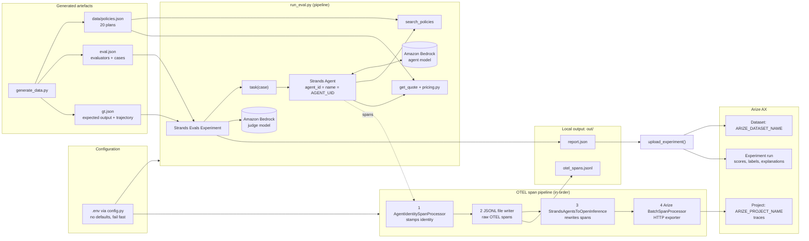
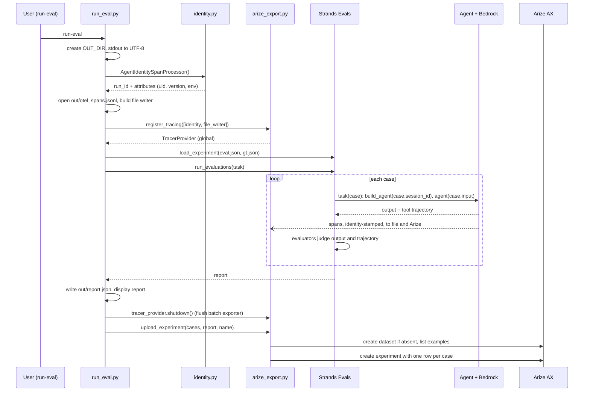

# Insurance Pricing Agent: Solution Brief and Build Specification


> Reconstructed from the code in this repository (`src/insurance_agent/*`, `.env.example`, `pyproject.toml`, `eval.json`, `gt.json`). The original build prompt is not stored in the repo, so this is written as the specification the code implements. Nothing here is stated that the code does not do.


## 1. Business Domain


- The domain is **insurance price comparison**. A customer states a policy type, their age, a coverage amount and a deductible.

- Four policy types are supported: **auto, home, term life and health**.

- The catalog holds **5 insurers** (Aegis Mutual, Northwind Assurance, Bluepeak Insurance, Cedar & Stone, Harbor Shield). Each offers one plan per policy type, so there are **20 plans**.

- The agent's job is to return **the cheapest plan** (plan name, insurer, plan_id) and its **annual premium in USD**.

- Prices come only from tool results, never from the model's own knowledge. This makes answers exactly checkable.


## 2. What We Build, Technically


### 2.1 Goal

A **Strands Agents** pricing agent on **Amazon Bedrock**, evaluated with **Strands Evals**. The pipeline stamps a stable agent identity on every OpenTelemetry span. It then **drains** the traces and the experiment results to **Arize AX**.


### 2.2 Stack (from `pyproject.toml`)

Python >= 3.12, managed with `uv` and built with `hatchling`.


| Package | Used for |

|---|---|

| `strands-agents` | Agent, `@tool`, `BedrockModel` |

| `strands-agents-evals` | `Case`, `Experiment`, evaluators, report |

| `boto3` | Explicit AWS session for Bedrock |

| `arize` | `ArizeClient`: datasets and experiments (REST) |

| `arize-otel` | `TracerProvider`, `HTTPSpanExporter`, `BatchSpanProcessor` |

| `openinference-instrumentation-strands-agents` | Converts Strands spans to Arize/OpenInference format |

| `opentelemetry-exporter-otlp-proto-http` | OTLP over HTTP |

| `python-dotenv` | Loads `.env` |

| `truststore` | OS certificate store for TLS to Arize |


CLI entry points: `generate-data` and `run-eval`.


### 2.3 Modules


| File | Responsibility |

|---|---|

| `config.py` | The only place that reads configuration. Loads `.env` from the repo root. **No defaults**: `required()` raises if a setting is missing or empty. `optional()`, `path()` (relative paths resolve against the repo root) and `required_uuid()` (raises on a malformed UUID) are also provided. |

| `pricing.py` | Deterministic premium formula, shared by the agent tools and the ground-truth generator. |

| `generate_data.py` | Builds the catalog, `eval.json` and `gt.json`. |

| `agent.py` | The Strands agent, its two tools and its system prompt. |

| `identity.py` | Agent version and the span processor that stamps identity on every span. |

| `arize_export.py` | Tracing setup (span pipeline to Arize), TLS handling and the experiment upload. |

| `run_eval.py` | Orchestrator: loads the experiment, runs it, writes local outputs, then drains to Arize. |


### 2.4 Data and the pricing formula

`generate_data.py` builds the catalog with `random.Random(42)`, so it is reproducible.


- **Plan ids**: `AUT-01`..`AUT-05`, `HOM-`, `TER-`, `HEA-` (first three letters of the policy type, upper-case, plus a two-digit index).

- **Plan names**: `<first word of insurer> <Policy Type> Basic|Plus`. Odd index is Basic, even index is Plus.

- **Plan fields**: `plan_id, insurer, policy_type, plan_name, rate_per_1000, annual_fee, min_coverage=10,000, max_coverage=2,000,000`.

- **Rate and fee ranges per policy type**:


| Type | rate_per_1000 | annual_fee |

|---|---|---|

| auto | 2.0 to 3.4 | 20 to 60 |

| home | 1.1 to 2.0 | 25 to 70 |

| term_life | 0.9 to 1.6 | 30 to 80 |

| health | 4.0 to 6.5 | 40 to 120 |


**Formula** (`pricing.py`):


```

premium = round( rate_per_1000 * coverage/1000 * age_factor * deductible_factor + annual_fee, 2 )

```


- **Deductible factor**: 500 → 1.15, 1000 → 1.0, 2500 → 0.85, 5000 → 0.72. Any other value raises `ValueError`.

- **Age factor**:

  - `term_life`: `1 + max(0, age-25) * 0.045`

  - `health`: `1 + max(0, age-18) * 0.02`

  - `auto` and `home`: 1.35 if age < 25, 1.0 if age < 65, otherwise 1.1


### 2.5 The agent (`agent.py`)

- **Model**: `BedrockModel(model_id=BEDROCK_MODEL_ID, boto_session=boto3.Session(region_name=AWS_REGION), temperature=AGENT_TEMPERATURE)`. Bedrock is reached through an **explicit boto3 session**.

- **System prompt**: you are an insurance pricing assistant. Call `search_policies` for the requested policy type, then call `get_quote` for **every** returned plan with the customer's age, coverage amount and deductible. Report the cheapest plan (plan name, insurer, plan_id) and its annual premium. Never invent prices; only use tool results.

- **Tool `search_policies(policy_type)`**: returns, for each plan of that type, `plan_id, insurer, plan_name, min_coverage, max_coverage`. Valid types are auto, home, term_life, health.

- **Tool `get_quote(plan_id, age, coverage_amount, deductible)`**: returns `plan_id, plan_name, insurer, annual_premium_usd`. It returns an `{"error": ...}` dict, rather than raising, for three cases: an unknown plan_id, coverage outside the plan limits, or an invalid deductible.

- **Agent construction**: `Agent(model, system_prompt, tools=[search_policies, get_quote], callback_handler=None, trace_attributes=..., agent_id=AGENT_UID, name=AGENT_UID)`.

- **Session tagging**: when a `session_id` is passed, `trace_attributes` carries `session.id` and `gen_ai.conversation.id`.


### 2.6 Evaluation (`eval.json` + `gt.json`)

- **Five cases**: `auto_young_driver`, `auto_mid_age_high_deductible`, `home_senior`, `term_life_30s`, `health_50s`.

- **`eval.json`** holds the evaluators and the cases (`name`, `input`, `metadata` = the scenario parameters).

- **`gt.json`** holds `expected_output` and `expected_trajectory` per case. It is **computed from the same catalog and formula the tools use**, so it is exact.

- **Expected trajectory**: `search_policies` once, then `get_quote` once per plan of that type (5 plans, so 5 quotes).

- **Merge**: `load_experiment()` joins the two files **by case name**. It raises if a case in `eval.json` is missing from `gt.json`.

- **Evaluators**:

  - `BestPriceCorrectness` (`OutputEvaluator`): must name the cheapest plan (insurer and plan name) with the premium within $1 of expected. Score 1.0 if both are correct, 0.5 if the plan is right but the premium is wrong or missing, 0.0 otherwise.

  - `ToolUsage` (`TrajectoryEvaluator`): `search_policies` first, then `get_quote` for every candidate plan. Score 1.0 if the order holds and every plan was quoted, 0.5 if only some were, 0.0 if none. It carries a `trajectory_description` for both tools.

- **Judge model**: `JUDGE_MODEL_ID` is injected as `model_id` into every evaluator. An evaluator in `eval.json` can override it with its own `model_id`.


## 3. Architecture





## 4. Code Flow (`run_eval.main`)





Step by step:


1. **Identity.** `AgentIdentitySpanProcessor()` reads `AGENT_UID`, `DEPLOY_ENV`, the optional `RUN_ID` and the agent version. It prints `run_id` and `agent.version`.

2. **Local span file.** A `SimpleSpanProcessor` with a `ConsoleSpanExporter` writes one JSON span per line to `out/otel_spans.jsonl`.

3. **Tracing.** `register_tracing([identity, file_writer])` builds the provider and adds the processors in a fixed order (see 5.3).

4. **Experiment.** `load_experiment()` merges `eval.json` and `gt.json` and builds `Experiment.from_dict(...)`.

5. **Task per case.** `task(case)` builds a fresh agent with `case.session_id`, calls it with `case.input`, and returns `{"output": str(result), "trajectory": [tool names]}`. The tool names come from `extract_agent_tools_used_from_messages(agent.messages)`.

6. **Evaluate and report.** `run_evaluations(task)` runs the cases and the judges. The report is written to `out/report.json` and displayed with actual and expected output.

7. **Flush.** `tracer_provider.shutdown()` flushes the Arize batch exporter. The span file is then closed.

8. **Drain to Arize.** `upload_experiment()` pushes the experiment results (see 5.4).


## 5. Features Covered


### 5.1 Agent identity retained across the pipeline

- **Stable UUID, not a friendly name.** `AGENT_UID` is a uuid4 minted once per agent. Two people can pick the same friendly name; a UUID is globally unique. `required_uuid()` rejects a malformed value.

- **`agent_id` and `name` both set to the UID.** The comment in `agent.py` gives the reason: Strands only emits `gen_ai.agent.name` on spans, and friendly names can collide.

- **Stamped on every span** (agent, model, tool and evaluation spans) by `AgentIdentitySpanProcessor.on_start`:


| Attribute | Value |

|---|---|

| `agent.uid` | `AGENT_UID` |

| `gen_ai.agent.id` | `AGENT_UID` |

| `agent.version` | `AGENT_VERSION` if set (e.g. a git SHA from CI), otherwise a content hash (see below) |

| `deployment.environment` | `DEPLOY_ENV` (`pipeline` or `agentcore`) |

| `run.id` | `RUN_ID` if set (must be a UUID), otherwise a new uuid4 per run |


- **Same identity on every runtime.** Where the agent runs is recorded only in `deployment.environment`, so the identity never changes between the local pipeline and AgentCore.

- **Content-hash version.** The default `agent.version` is the first 12 hex characters of a SHA-256 over `agent.py`, `pricing.py` and the catalog file, with CRLF normalised to LF. The same files give the same version on Windows and Linux, and on any runtime.

- **Session tagging.** `session.id` and `gen_ai.conversation.id` are set from `case.session_id`.

- **Identity processor goes first.** Every span that is exported, including those written to the JSONL file, carries the identity attributes.


### 5.2 Configuration discipline

- Everything is read from the environment or `.env`, through `config.py` only.

- A missing setting raises `RuntimeError: Missing required setting X. Set it in .env (see .env.example).`

- Settings in `.env.example`: `AWS_REGION`, `BEDROCK_MODEL_ID`, `JUDGE_MODEL_ID`, `AGENT_TEMPERATURE` (0.0), `AGENT_UID`, `DEPLOY_ENV`, `DATA_PATH`, `EVAL_PATH`, `GT_PATH`, `OUT_DIR`, `ARIZE_SPACE_ID`, `ARIZE_API_KEY`, `ARIZE_PROJECT_NAME`, `ARIZE_DATASET_NAME`, `ARIZE_COLLECTOR_ENDPOINT`. Optional: `AGENT_VERSION`, `RUN_ID`.

- AWS credentials come from `AWS_ACCESS_KEY_ID`, `AWS_SECRET_ACCESS_KEY` and `AWS_SESSION_TOKEN`, or an IAM role.


### 5.3 Draining traces to Arize

`register_tracing()` in `arize_export.py`:


- Creates an `arize.otel.TracerProvider` with space id, API key, project name, endpoint and `Transport.HTTP`, and sets it as the global tracer provider.

- The `Resource` carries `PROJECT_NAME` and `ARIZE_PROJECT_TYPE_ATTR="application"`. Arize routes on the project name, and a bare `TracerProvider` does not set it.

- **Processor order**:

  1. The identity processor and the JSONL writer (the `processors` argument), in the order given.

  2. `StrandsAgentsToOpenInferenceProcessor`. It rewrites Strands spans **in place** into Arize format, so anything before it sees the raw OTEL spans.

  3. `BatchSpanProcessor` with `HTTPSpanExporter`, last, so it sends the converted spans.

- The exporter uses a `requests.Session` with `Connection: close`. The code comment says reused connections stall and drop span batches on this network.


### 5.4 Draining experiment results to Arize

`upload_experiment(cases, report, experiment_name)`:


- **Dataset.** If no dataset named `ARIZE_DATASET_NAME` exists in the space, it is created from the cases (`name, input, expected_output, expected_trajectory, metadata`). If it exists, it is reused.

- **Example matching.** Examples are matched to cases by `name`. If any case has no example, it raises `RuntimeError` telling you to use a new `ARIZE_DATASET_NAME` or add the examples.

- **One row per case**, with `example_id`, `output` (the actual output) and `actual_trajectory`.

- **Per evaluator**, three columns: `<Evaluator>.score`, `.label` and `.explanation`.

- **Failed cases.** If a task or evaluator raised, there is no actual output. The error reason is used as the output, because Arize rejects an empty output, and the label is `"ERROR"`.

- **Experiment name.** `<agent.version>-<first 8 chars of run_id>`, so each run is traceable to a build and a run.

- **Creation.** `client.experiments.create(...)` is called with `ExperimentTaskFieldNames(output="output", example_id="example_id")` and `EvaluationResultFieldNames` per evaluator.


### 5.5 TLS on corporate networks

- Corporate networks re-sign HTTPS with a CA that `certifi` does not know. Arize calls therefore verify against the **OS certificate store** through `truststore`.

- **Trace export**: `_OsTrustAdapter`, an `HTTPAdapter` that uses `truststore.SSLContext`, is mounted on the exporter's session.

- **REST client**: `_os_trust_store()` is a context manager that calls `truststore.inject_into_ssl()` and then `extract_from_ssl()`. It wraps only the upload.

- **It is deliberately not injected globally.** Doing so makes botocore (Bedrock) raise `RecursionError`. The context manager is only safe after the evaluation has finished, when no other thread is creating boto clients.


### 5.6 Local outputs (`out/`)

- `otel_spans.jsonl`: raw OTEL spans, one JSON object per line.

- `report.json`: the Strands Evals report.

- The console report uses emoji, so `sys.stdout.reconfigure(encoding="utf-8")` is set for Windows consoles that default to cp1252.


### 5.7 Quality properties

- **Exact ground truth**: expected answers come from the same catalog and formula as the tools.

- **Reproducible data**: seeded generator.

- **Deterministic agent**: temperature is set explicitly (0.0 in `.env.example`).

- **Safe tool errors**: tools return error dicts and do not crash the agent loop.

- **Fail fast configuration**: no hidden defaults.


## 6. How to Run


```

uv sync

copy .env.example .env      # fill in the values; mint AGENT_UID with uuid4

uv run generate-data        # writes data/policies.json, eval.json, gt.json

uv run run-eval             # runs the agent + evaluators, writes out/, drains to Arize

```


The run prints `run_id` and `agent.version` at the start. At the end it prints the paths of the local outputs and the Arize project and dataset names.
